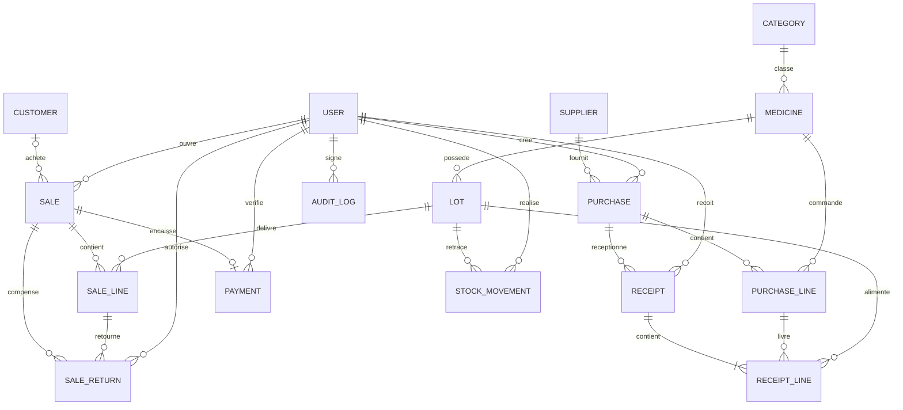
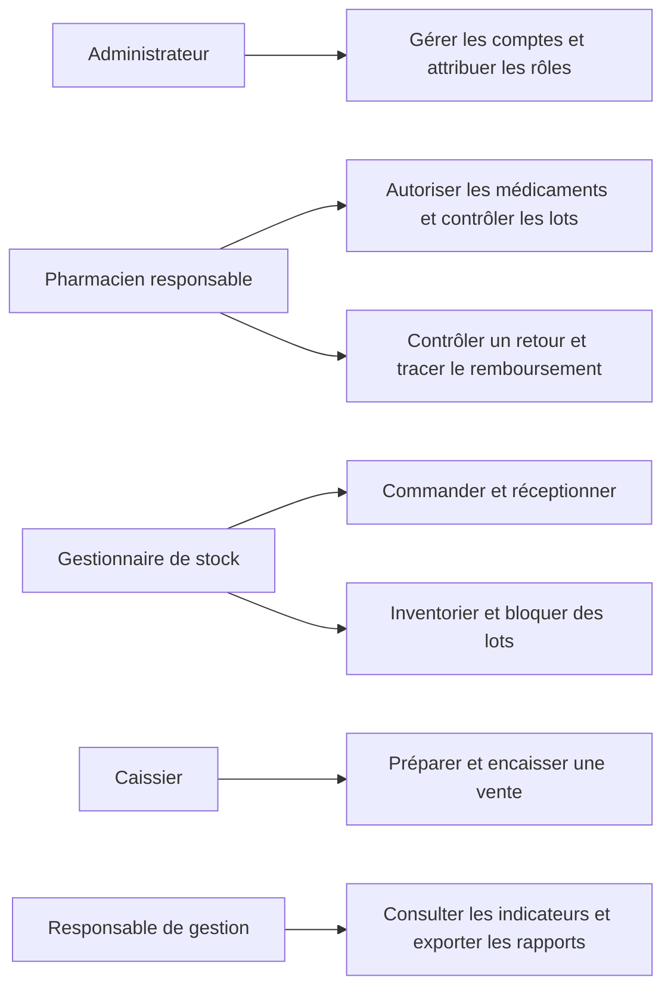
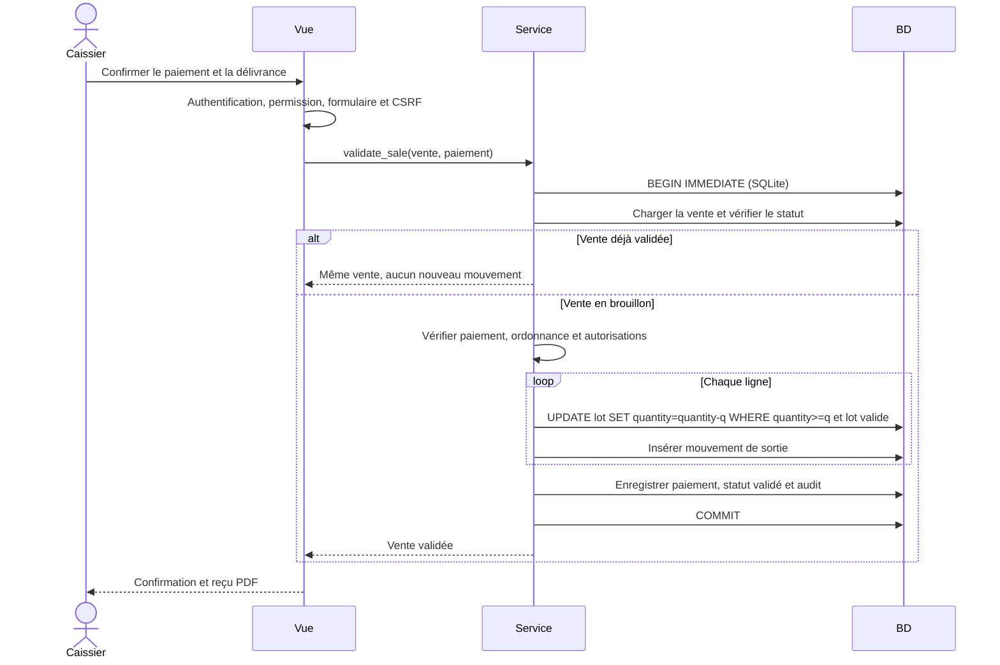
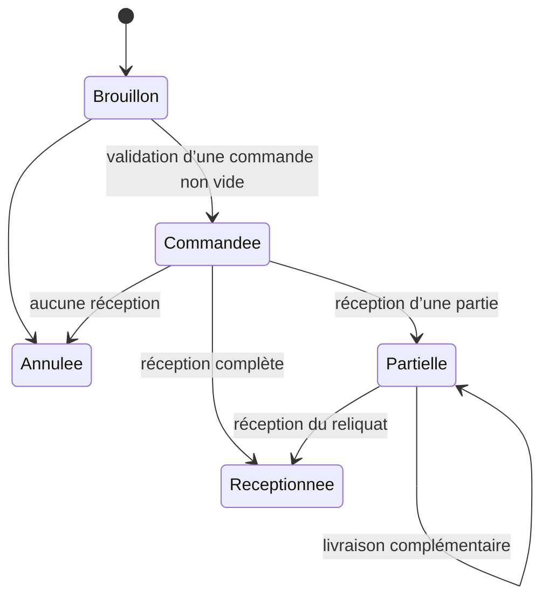

# Dossier de conception

## Architecture

Django MVT : `pharmacy/models.py` définit les relations et contraintes SQL ; `forms.py` valide les saisies ; `services.py` centralise les mutations atomiques et leurs permissions ; `views.py` applique les contrôles d’accès et présente les données. Les modèles métier sont regroupés dans une application pour garder le projet lisible ; les modules sont séparés par responsabilités. L’administration laisse les opérations commerciales en lecture seule pour éviter les modifications directes du stock.

`config/` contient configuration, routage et WSGI. `templates/pharmacy/` regroupe les écrans métier, `templates/registration/` l’authentification, `static/css/` le style. Les commandes sont dans `pharmacy/management/commands/` et les tests dans `pharmacy/tests.py`.

## MCD (Mermaid)

## MLD

Les clés `id` sont des entiers auto-incrémentés. Les références ci-dessous sont des clés étrangères protégées (`PROTECT`), sauf les relations des groupes Django. Les migrations font foi pour les types et contraintes exacts.

| Table | Attributs principaux et relations |
|---|---|
| Category | id, name UNIQUE, description |
| Medicine | id, category_id FK, name, generic_name, form, dosage, manufacturer, barcode UNIQUE NULL, photo, purchase_price, sale_price, threshold, active, authorized, requires_prescription, created_at |
| Supplier | id, name, address, phone, email, tax_id, contact, active |
| Customer | id, name, phone, address, active |
| Purchase | id, supplier_id FK, author_id FK User, status, created_at |
| PurchaseLine | id, purchase_id FK, medicine_id FK, quantity, received, unit_price |
| Receipt | id, purchase_id FK, author_id FK, token UUID UNIQUE, created_at |
| ReceiptLine | id, receipt_id FK, purchase_line_id FK, lot_id FK, quantity, unit_cost |
| Lot | id, medicine_id FK, number, expires_on, quantity, received_quantity, unit_cost, blocked ; UNIQUE(medicine_id, number) |
| Sale | id, customer_id FK NULL, author_id FK, status, created_at, validated_at NULL, prescription_checked |
| SaleLine | id, sale_id FK, lot_id FK, quantity, returned, unit_price, unit_cost |
| Payment | id, sale_id FK UNIQUE, method, amount, confirmed, reference, verified_by_id FK, created_at |
| SaleReturn | id, sale_id FK, line_id FK, quantity, reason, restock, amount, refund_reference, token UUID UNIQUE, author_id FK, created_at |
| StockMovement | id, lot_id FK, quantity signée, kind, reason, receipt_id FK NULL, sale_id FK NULL, return_record_id FK NULL, author_id FK, created_at |
| AuditLog | id, author_id FK, action, target, created_at |
| Utilisateurs | Tables natives auth_user, auth_group, auth_permission et tables associatives |

Les prix utilisent des décimaux à deux chiffres après la virgule. Les coûts historiques sont enregistrés par lot et ligne de vente. Les quantités ne peuvent pas être négatives ; les quantités de transaction et les prix doivent être strictement positifs. Les quantités reçues et retournées sont limitées aux quantités d’origine.

Le stock physique est matérialisé dans `Lot.quantity` pour les mises à jour atomiques et sa variation est toujours associée à un mouvement. Le stock disponible exclut les lots périmés et bloqués. Les médicaments inactifs ou non autorisés sont également refusés par le service de vente.

## Cas d’utilisation

## Validation d’une vente

Toute erreur provoque un rollback de l’ensemble, y compris si une première ligne était disponible et qu’une ligne suivante ne l’est plus. Les saisies ne peuvent pas modifier directement les prix historiques d’une vente validée.

## Cycle des commandes

Une réception porte un jeton unique et des lignes distinctes de la commande. La même réception ne peut donc alimenter deux fois le stock. Le service accepte plusieurs lignes atomiques ; l’écran propose de réceptionner les lots successivement.
