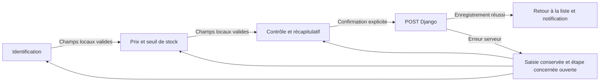

# Conception et intégration — formulaires accompagnés

Cette itération complète la refonte initiale. Son objectif est de réduire l’effort de saisie et de rendre les retours plus explicites, sans changer les opérations métier ni les permissions.

## Parcours du médicament

Le formulaire de création et celui de modification utilisent le même parcours :



1. **Identification** : nom, générique, catégorie, forme, dosage, laboratoire, code-barres et photo.
2. **Prix et seuil de stock** : achat, vente et seuil, avec unités et aide contextuelle.
3. **Contrôle et récapitulatif** : statut actif, ordonnance requise, autorisation de délivrance et résumé de l’ensemble des valeurs.

Chaque étape possède un titre, un indicateur de progression et un bouton Continuer. Les étapes vérifiées portent une coche et un libellé accessible ; la couleur n’est pas leur seul signe distinctif. Les étapes déjà visitées restent accessibles. Avancer revérifie les sections intermédiaires. Le récapitulatif permet de revenir aux champs avec « Modifier ».

Aucun appel serveur ni stockage navigateur ne conserve un brouillon à chaque étape. Tous les contrôles appartiennent au même formulaire, avec le même jeton CSRF et le même POST multipart final. La photo choisie reste dans le contrôle fichier pendant les déplacements entre étapes. Comme avec tout upload HTML, un rechargement ou une réponse serveur invalide peut imposer de sélectionner de nouveau un fichier qui n’a pas encore été enregistré.

Sans JavaScript, les trois sections restent visibles, les boutons de progression sont masqués et le bouton final est accessible. Après une erreur serveur, les sections restent toutes disponibles dans le HTML ; l’amélioration JS ouvre celle qui contient la première erreur. Le résumé d’erreurs conserve ses liens et peut ouvrir une autre étape.

## Contrats de retour

| Situation | Composant et comportement |
|---|---|
| Champ non encore utilisé | Aide contextuelle, sans alerte prématurée |
| Valeur invalide après interaction | Message correctif sous le champ et association `aria-describedby` |
| Valeur corrigée localement | L’erreur locale s’efface ; aucun succès serveur n’est annoncé |
| Erreur serveur précédente | Conservée sous le libellé « Au dernier envoi » jusqu’à une nouvelle réponse serveur |
| Continuer avec des erreurs | Rester sur la section et focaliser le premier champ concerné |
| Enregistrer avec une erreur dans une section précédente | Réouvrir cette section avant de focaliser le champ |
| Enregistrement réussi | Notification en flux, fermable manuellement, sans durée imposée |
| Erreur opérationnelle | Alerte persistante ; aucune disparition automatique |
| Recherche en cours | Message et squelette léger ; résultats précédents conservés |
| Recherche automatique impossible | Message visible et bouton Rechercher toujours fonctionnel |

Les notifications restent dans le flux du contenu : elles ne recouvrent ni panier, ni total, ni contrôles. Le succès d’une vente conserve sa confirmation métier persistante et ses liens de document.

## Validation locale et serveur

La validation locale réutilise les contraintes HTML : présence, e-mail, bornes, pas numérique et longueurs. Les bornes déclarées par les validateurs du modèle sont projetées dans les widgets par un helper de présentation. Les prix strictement positifs restent également contrôlés par Django et les contraintes de base de données.

Les photos bénéficient d’une aide sur les extensions autorisées et la limite de 5 Mo. Le contenu réel reste contrôlé côté serveur par le formulaire/image Pillow. La validation locale ne vérifie ni l’unicité d’un code-barres, ni la disponibilité fiable d’un lot, ni une permission, ni un paiement.

Le script prend en charge les messages de correction uniquement après son initialisation. `novalidate` n’est pas livré dans le HTML : sans JS, le comportement natif est conservé. La vérification avant soumission s’exécute avant le verrouillage des boutons déjà présent dans `app.js` ; un formulaire invalide ne passe donc pas en état « enregistrement en cours ».

## Composants et fichiers

| Fichier | Responsabilité |
|---|---|
| `static/css/experience.css` | Stepper, récapitulatif, erreurs locales, notifications et chargement ; états mobiles et réduction des animations |
| `static/js/forms.js` | Validation contextuelle, progression, résumé de saisie, navigation vers les erreurs et fermeture des notifications |
| `static/js/app.js` | Interactions existantes ; chargement de recherche avec message de repli visible |
| `pharmacy/templatetags/ui.py` | Aides éditoriales, attributs accessibles et projection des bornes ; aucun changement de données |
| `templates/includes/field.html` | Emplacement du retour inline, aides, historique d’erreur serveur |
| `templates/includes/form_fields.html` | Sections communes et progression facultative |
| `templates/includes/messages.html` | Succès fermable, avertissements et erreurs persistants |
| `templates/includes/search_loading.html` | Indicateur commun, initialement masqué |
| `templates/pharmacy/form.html` | Activation du parcours progressif uniquement pour les médicaments |
| `templates/base.html` | Chargement local des styles et scripts dans leur ordre d’exécution |
| Listes catalogue/stock/achats/ventes/mouvements/audit | Insertion de l’indicateur de recherche, sans changement des requêtes métier |
| `pharmacy/test_ui.py` | Contrats HTML et tests de non-enregistrement en cas d’erreur |
| `tools/ux_browser_check.cjs` | Parcours navigateur facultatif du wizard et du repli sans JS |

Les modèles, les vues, les services métier, les formulaires Python et les migrations n’ont pas changé.

## Accessibilité et sobriété

- Corps 16 px et aides 14 px, palette sémantique de la refonte précédente.
- Cibles de progression et de fermeture d’au moins 44 px.
- Focus visible ; déplacement vers la légende de section ou le champ à corriger.
- Indication de l’étape active avec `aria-current="step"` et annonce de progression.
- Messages inline polis ; les erreurs serveur restent lisibles dans le résumé et près des champs.
- Récapitulatif rendu avec `textContent` : les valeurs saisies ne deviennent pas du HTML.
- Animations courtes, uniquement lorsque `prefers-reduced-motion` ne demande pas leur réduction.
- Aucune police distante, bibliothèque frontend, compilation ou requête de validation externe.
- Aucun stockage local des coordonnées ou saisies médicales/commerciales.

## Vérifications exécutées

- Suite complète : **63 tests Django réussis**, dont sept nouveaux contrats sur la progression, les attributs de saisie, les photos, les erreurs serveur, les notifications et le repli HTML.
- Syntaxe vérifiée par Node pour `forms.js`, `app.js` et le script de recette navigateur.
- `manage.py check` sans anomalie et aucune migration à générer.
- `git diff --check` sans erreur ; comparaison SHA-256 identique pour les modèles, vues, services, formulaires Python et migration initiale.

## Recette complémentaire

Le script de recette existant accepte maintenant `UX_WIZARD=1`. Utiliser un compte fictif autorisé à créer un médicament et au moins une catégorie fictive :

```bash
export UX_WIZARD=1
node tools/ux_browser_check.cjs
```

Configurer le compte et Playwright comme décrit dans `RECETTE_UX.md`. Le script visite la création aux quatre largeurs, essaie Continuer à vide, corrige les champs, vérifie une erreur de prix, le montant français dans le résumé et la conservation de la photo lors des retours. Il ne clique pas sur l’enregistrement final et ne crée aucun médicament.

Contrôles manuels à compléter :

- [ ] 360 / 768 / 1280 / 1920 px : progression, formulaires, résumé et notifications sans débordement.
- [ ] Navigation intégrale au clavier, focus après changement d’étape et liens du résumé d’erreurs.
- [ ] Code-barres déjà utilisé : réponse Django et ouverture de l’étape Identification.
- [ ] Prix incorrect côté serveur : saisie conservée, étape des prix ouverte.
- [ ] Photo choisie puis Précédent/Continuer : fichier toujours sélectionné.
- [ ] Modification avec photo existante : résumé exact ; effacement ou remplacement compris.
- [ ] Sans JS : toutes les sections visibles et création complète possible.
- [ ] Contrôle au lecteur d’écran et avec réduction des animations.
- [ ] Notification fermée au clavier : focus conservé dans le document.
- [ ] Réseau lent ou interrompu : résultat précédent conservé et repli visible.

Le lancement de Chromium reste interdit par l’environnement d’exécution (`Operation not permitted`). Les tests Django et les contrôles de syntaxe n’attestent pas du rendu ni des interactions dans un navigateur. Le script et les cas manuels sont fournis pour cette validation distincte.

## Suite de la conception

Après recette de ce composant sur les médicaments : étudier son intérêt pour la création de comptes. Conserver les opérations fréquentes de caisse, réception et inventaire sur un écran. Le thème sombre et les tendances statistiques restent des itérations séparées, à concevoir et valider avec leurs propres états.
